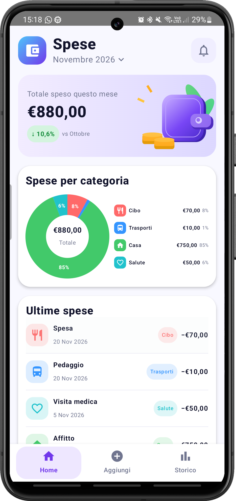
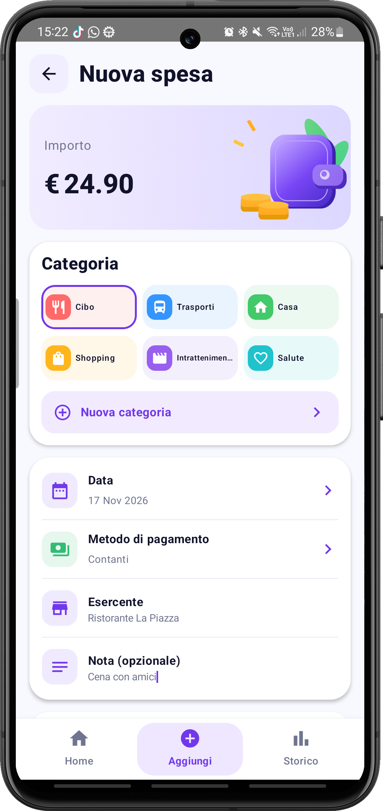
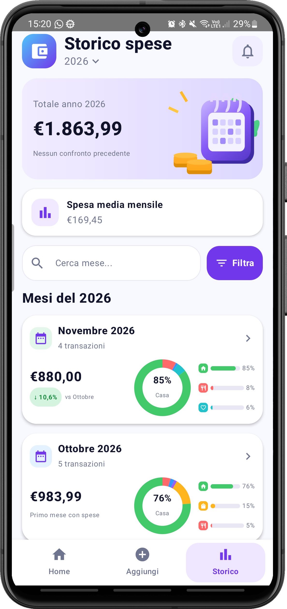
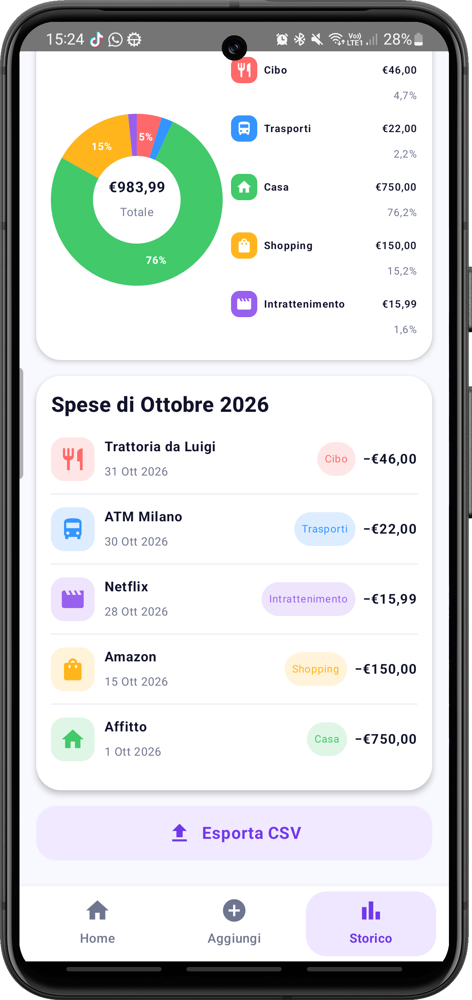
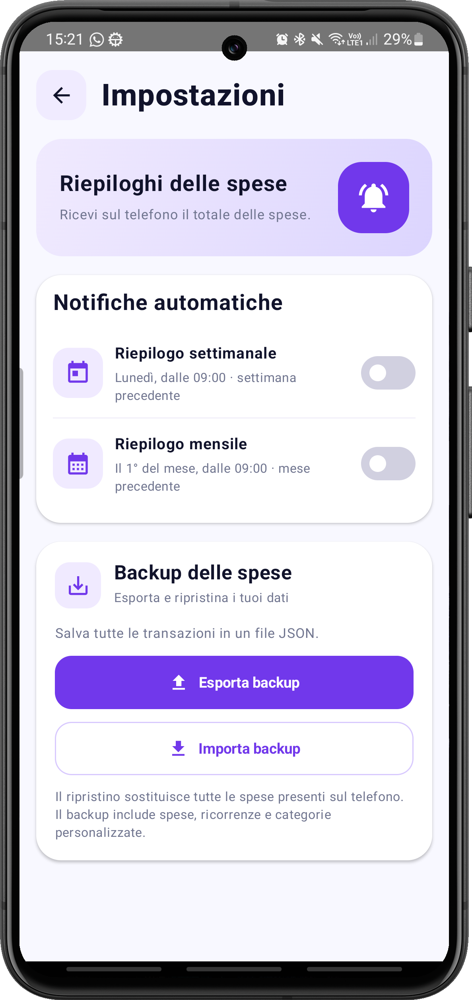

<div align="center">
  

  # Spesì

  **Le tue spese, sotto controllo.**

  App Android open source per registrare e analizzare le spese personali, con un'interfaccia semplice e colorata.

  
  
  
</div>

<p align="center">
  <a href="https://github.com/gisolfi02/Spesi/releases/latest">
    
  </a>
</p>

## Che cos'è Spesì?

Spesì aiuta a tenere traccia delle spese quotidiane e a capire come vengono distribuite nel tempo. Non richiede la creazione di un account e le funzioni principali sono disponibili senza connessione Internet.

## Funzionalità

- **Dashboard mensile:** totale delle spese, confronto con il mese precedente e grafico a ciambella per categoria.
- **Gestione delle spese:** aggiunta, consultazione, modifica ed eliminazione delle singole transazioni.
- **Categorie:** sei categorie predefinite e possibilità di crearne di personalizzate con nome, icona e colore. Le categorie archiviate rimangono associate alle spese storiche.
- **Spese ricorrenti:** registrazione di spese con frequenza settimanale, mensile, trimestrale e altre periodicità.
- **Storico:** riepiloghi annuali, dettaglio dei singoli mesi ed esportazione delle transazioni mensili in CSV.
- **Notifiche facoltative:** riepiloghi settimanali e mensili delle spese.
- **Backup e ripristino:** esportazione e importazione dei dati tramite file JSON.

## Screenshot

<p align="center">
  
  
  
  
  
</p>

## Download e installazione

Spesì è disponibile gratuitamente per Android 8.0 e versioni successive.

1. Clicca su **Scarica Spesì**.
2. Nella pagina della release, espandi la sezione **Assets**.
3. Scarica il file `.apk` della versione più recente.
4. Apri il file sul tuo smartphone e autorizza
   l'installazione da questa sorgente, se richiesto.
5. Installa e avvia Spesì.

Non sono necessari account o connessione Internet
per utilizzare le funzionalità dell'app.

## Tecnologie

- **Kotlin** e **Jetpack Compose** per la UI Android.
- **Room / SQLite** per la persistenza locale delle spese.
- **DataStore** per le preferenze.
- **WorkManager** per le attività pianificate, comprese le notifiche e le ricorrenze.
- **Gradle** per la compilazione.

## Requisiti

- Android **8.0 (API 26)** o successivo.
- Per compilare il progetto: Android Studio con gli SDK richiesti dal progetto installati.

## Come compilare e provare l'app

1. Clona il repository:

   ```bash
   git clone https://github.com/gisolfi02/Spesi.git
   ```

2. Apri la cartella `Spesi` con **Android Studio**.
3. Attendi la sincronizzazione di Gradle e l'installazione degli SDK eventualmente richiesti.
4. Seleziona un emulatore o un dispositivo Android con il debug abilitato.
5. Premi **Run** per compilare e avviare l'app.

## Dati e privacy

Le spese vengono registrate nel database locale dell'app. Spesì non richiede un account né un server per funzionare. I file JSON di backup possono contenere informazioni finanziarie personali **in chiaro**: conservali in un luogo sicuro e condividili soltanto se necessario.

La gestione degli eventuali backup di sistema dipende anche dalle impostazioni del dispositivo Android.

## Contributi

Segnalazioni di bug, suggerimenti e proposte sono benvenuti nella sezione [Issues](https://github.com/gisolfi02/Spesi/issues).

## Licenza

Questo progetto è distribuito sotto licenza **MIT**. Consulta il file [LICENSE](LICENSE) per i termini completi.
